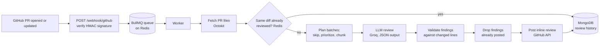

# AI Code Review Agent for GitHub Pull Requests
x
A Node.js service that listens for GitHub pull request webhooks, reviews the diff with an LLM, and posts the findings as **inline review comments on the exact changed lines**, like a junior engineer doing a first-pass review.


## How it works



1. GitHub sends a `pull_request` webhook (`opened` or `synchronize`). The server verifies the HMAC-SHA256 signature against the raw request body, queues a job, and answers immediately.
2. A worker fetches the PR's file diffs, then checks Redis for an identical diff that was already reviewed.
3. The diff is planned into batches: lockfiles, generated and binary files are skipped, source code is prioritized over tests and docs, and oversized files are cut at hunk boundaries.
4. Each batch is sent to the LLM with line-numbered diffs, and the model must answer in a fixed JSON schema.
5. Every finding is validated: the file must be in the PR and the line must be an added line. Anything else is dropped, so a comment never lands on the wrong line.
6. Findings already posted on earlier commits of the same PR are filtered out, and the rest are posted as a single GitHub review.
7. The run is saved to MongoDB for history and stats.

## Features

- **Webhook security:** HMAC-SHA256 verification with a timing-safe comparison on the raw body
- **Validated structured output:** the LLM's JSON is parsed defensively (handles code fences and non-JSON replies) and every finding is checked against the real diff
- **Quota-aware job queue:** BullMQ with exponential backoff, a rate limiter, idempotent job ids, and no retries for permanent errors (401, 404, 422)
- **Two-level deduplication:** Redis cache keyed on a hash of the diff, plus per-finding fingerprints (file + text of the flagged line) so repeated pushes don't repeat the same comment
- **Diff chunking:** skips noise, prioritizes files, batches within a character budget, caches per batch so a retry doesn't redo finished work, and lists anything it couldn't review in the PR
- **Review history:** MongoDB records and a token-protected stats API. If MongoDB is down, reviews still run
- **Tests:** Jest unit tests with the LLM and cache mocked

## Tech stack

Node.js, Express, BullMQ, Redis (ioredis), MongoDB (Mongoose), Octokit, Groq API (via the OpenAI SDK), Jest, Docker Compose

## Project structure

```
server.js       Express app: webhook endpoint, history API, starts the worker
signature.js    Webhook HMAC verification
queue.js        BullMQ queue and worker (retries, backoff, rate limit)
reviewJob.js    The review pipeline run by the worker
github.js       Octokit: fetch PR files, post the review
llm.js          Diff planning, line numbering, LLM call, finding validation
cache.js        Redis: diff cache and posted-finding dedup
db.js           MongoDB: review history and stats
tests/          Jest tests
chunktest.js    Manual script to inspect how a PR would be batched
```

## Getting started

### Prerequisites

- Node.js 18 or newer
- Docker (for Redis and MongoDB), or your own Redis and MongoDB
- A [Groq](https://console.groq.com) API key (free tier available)
- [ngrok](https://ngrok.com) or any public URL so GitHub can reach your machine

### 1. Install

```bash
git clone https://github.com/anshu-agrawal02/ai-pr-review-agent.git
cd ai-pr-review-agent
npm install
cp .env.example .env
```

Fill in `.env` (see the configuration table below).

### 2. Create a GitHub token

Create a fine-grained personal access token limited to the repositories you want reviewed, with:

- Pull requests: **Read and write**
- Contents: Read-only
- Metadata: Read-only

Put it in `.env` as `GITHUB_TOKEN`. Tokens expire, so renew it when needed.

### 3. Run it

**With Docker Compose (app + Redis + MongoDB):**

```bash
docker compose up --build
```

**Or locally:**

```bash
docker run -d --name redis -p 6379:6379 redis:7
# start MongoDB however you prefer, then:
node server.js
```

### 4. Connect GitHub

Expose port 3000 (for example `ngrok http 3000`), then in your repository go to **Settings → Webhooks → Add webhook**:

- **Payload URL:** `https://<your-public-url>/webhook/github`
- **Content type:** `application/json`
- **Secret:** the same value as `GITHUB_WEBHOOK_SECRET`
- **Events:** only *Pull requests*

Open a pull request and the bot will comment on it.

## Configuration

| Variable | Required | Description |
|---|---|---|
| `GITHUB_WEBHOOK_SECRET` | yes | Shared secret used to verify webhook signatures |
| `GITHUB_TOKEN` | yes | GitHub token used to read PRs and post reviews |
| `GROQ_API_KEY` | yes | Groq API key |
| `GROQ_MODEL` | no | Model name (default `openai/gpt-oss-120b`). Providers retire models, so this is configurable |
| `REDIS_URL` | no | Default `redis://127.0.0.1:6379` |
| `MONGODB_URI` | no | Default `mongodb://127.0.0.1:27017/pr-review-agent` |
| `ADMIN_TOKEN` | no | Enables the history API. If unset, those endpoints don't exist |
| `PORT` | no | Default `3000` |
| `BATCH_CHAR_BUDGET` | no | Max characters of diff per LLM call (default 8000) |
| `MAX_BATCHES` | no | Max LLM calls per PR (default 4) |
| `BACKOFF_BASE_MS` | no | First retry delay in ms; doubles each attempt (default 15000) |
| `SIMULATE_429` | no | Testing only: fail the first two attempts of every job with a fake rate-limit error |

## API

| Endpoint | Description |
|---|---|
| `GET /` | Health check |
| `POST /webhook/github` | GitHub webhook receiver (signature required) |
| `GET /api/reviews?limit=20&repo=name` | Recent review runs. Requires header `x-admin-token` |
| `GET /api/stats` | Totals: runs, cache hits, findings posted, average review time, findings by severity. Requires header `x-admin-token` |

## Testing

```bash
npm test
```

The tests need no network, no API quota, and no Redis or MongoDB. They cover:

- Webhook signature verification (valid, tampered, wrong secret, missing, wrong length)
- Diff planning: skipping files, priority order, new-file line numbering, hunk-level truncation, the per-PR batch limit
- LLM handling with the LLM mocked: valid findings, dropping findings on unchanged lines or unknown files, JSON in code fences, non-JSON output, rethrowing 429s so the queue can retry, batch caching

Not covered by automated tests: the BullMQ retry behavior (checked manually with simulated 429 errors and a synthetic burst of jobs), the GitHub posting call (checked on real PRs), and the Redis and MongoDB code.

## Design decisions

- **Why a queue:** LLM free tiers have strict per-minute limits. The webhook only enqueues, and a single worker with a rate limiter and backoff processes jobs, so bursts of PRs don't blow through the quota or time out GitHub's webhook delivery.
- **Why validate line numbers:** LLMs are unreliable at counting lines in a diff. The diff is annotated with real line numbers before it's sent, and every finding is checked against the set of lines that were actually added. Invalid findings are dropped instead of guessed at.
- **Why fingerprint findings by line text, not line number:** line numbers shift as a PR changes, but the text of the flagged line identifies the problem.
- **Why the raw body for signatures:** GitHub signs the exact bytes it sent. Re-serializing parsed JSON changes the bytes and breaks verification.
- **Why cache after posting:** a run that fails halfway is never marked as done, so a retry does the work again.

## Known limitations

- **Free-tier limits are real.** If the daily quota is exhausted, a job retries up to 6 times with backoff and then fails. The bot does not yet post a "review delayed" notice.
- **Rate-limit handling was tested with simulated errors,** not against a real sustained rate limit.
- **The worker reviews the PR's current files when the job runs,** not strictly the commit that triggered it. If someone pushes twice in quick succession, a job may review newer code than its commit SHA says.
- **Only completed runs and cache hits are written to the history.** Failed jobs are not.
- **Comments are posted under the token owner's account,** not a dedicated GitHub App bot.
- **The reviewer only sees the diff,** not the whole repository, so it can miss problems that need wider context. Its findings are suggestions and can be wrong.
- **Large PRs are only partly reviewed.** At most `MAX_BATCHES` LLM calls are made per PR, and the review lists what was skipped.

## Roadmap

- Convert to a GitHub App so reviews come from a bot identity
- Record failed jobs in the history
- Post a "review delayed" comment when the quota is exhausted
- Count real LLM requests (not jobs) in the rate limiter
- Review the exact commit that triggered the job
- Deploy to an always-on host with HTTPS
